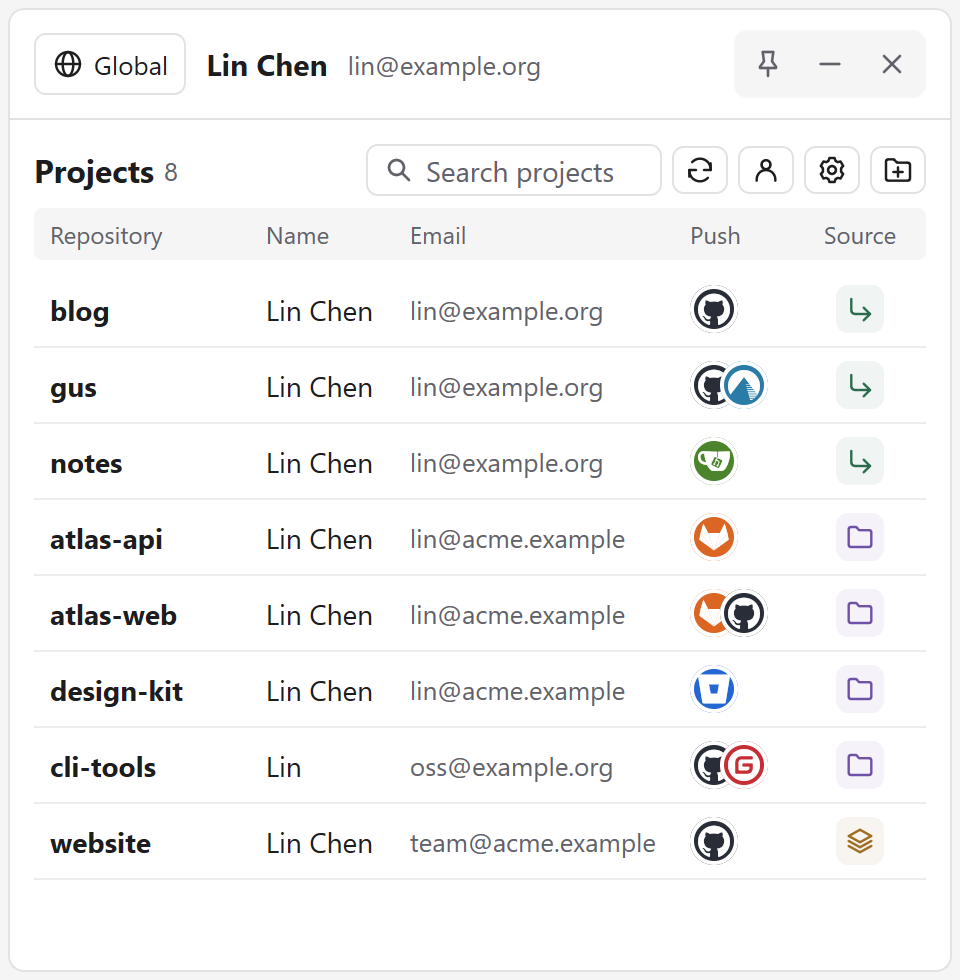
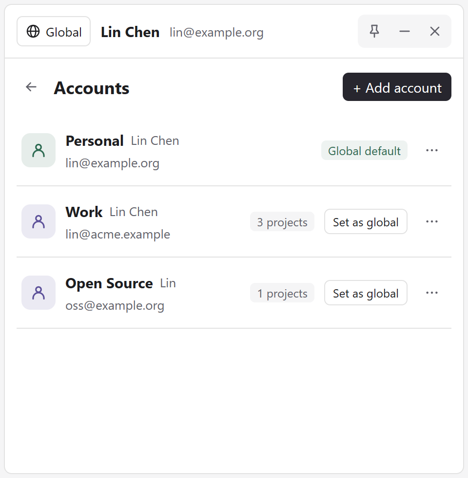
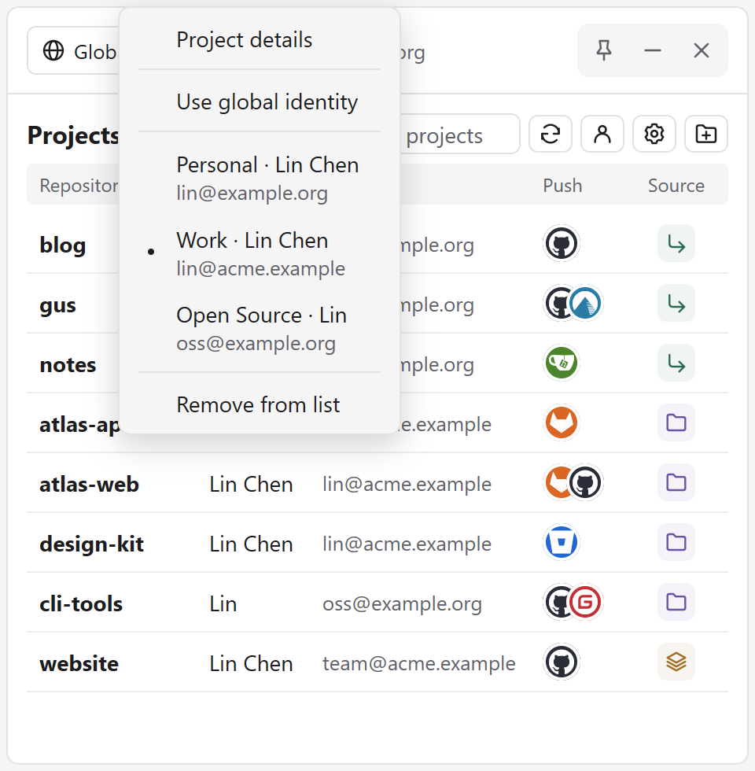
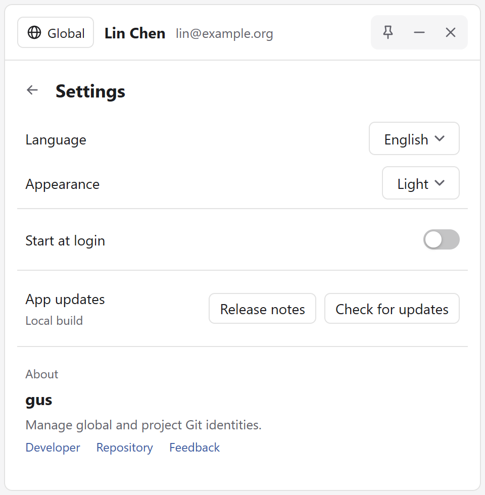

  

<h1 align="center">gus</h1>

  Manage Git commit identities across all your repositories. 
  <b>Native Desktop UI · Standalone Portable Binary · Windows, macOS & Linux</b>

  
  
  
  
  

  <b>English</b> · <a href="README.zh-CN.md">简体中文</a>

  

📸 <b>More Screenshots</b> (Accounts, Identity Switch & Settings)

 
<table align="center">
  <tr>
    <th>Account Profiles</th>
    <th>Right-Click Identity Switch</th>
  </tr>
  <tr>
    <td></td>
    <td></td>
  </tr>
  <tr>
    <th colspan="2">Settings</th>
  </tr>
  <tr>
    <td colspan="2" align="center"></td>
  </tr>
</table>

## ✨ Features

- **Multi-Account Profiles** — Save Git identities (`user.name` & `user.email`) for Personal, Work, or Open Source projects and track how many repositories use each profile.
- **One-Click Identity Switching** — Right-click any repository to assign a dedicated identity, switch accounts, or revert to inheriting your global default.
- **Visual Audit at a Glance** — Inspect repository name, active author, email, push hosting platforms (GitHub, GitLab, Gitea, Codeberg, Bitbucket, Gitee, etc.), and identity scope in one unified panel.
- **Instant Startup & Background Refresh** — Displays cached repository states immediately on launch and refreshes projects concurrently in the background.
- **Tray-First Workflow** — Runs quietly in the system tray with Always-on-Top pin mode, drag-and-drop folder import, instant search, Light/Dark themes, and English / Simplified Chinese UI.
- **Native & Portable** — Built with native desktop UI — no Electron or WebView2 bloat. Available as a standalone single-file executable (no installation required) or native installer.

## 📦 Download

Get the latest release for your platform from **[GitHub Releases](https://github.com/Hunlongyu/gus_gui/releases/latest)**:

| Platform | Standalone / Portable | Installer / Package |
| :--- | :--- | :--- |
| **Windows** *(x64 / ARM64)* | `gus-<version>-windows-<arch>.exe` *(Single EXE, no install)* | `gus-setup-<version>-<arch>.exe` |
| **macOS** *(Universal)* | `gus-<version>-darwin-universal.tar.gz` | `gus-<version>.dmg` |
| **Linux** *(x64 / ARM64)* | `gus-<version>-linux-<arch>` *(Single binary)* | `gus_<version>_<arch>.deb` |

> **Note:** Requires `git` in your system `PATH`. Windows and Linux standalone binaries have all icons and assets embedded — just download and run.

## ⌨️ Controls & Indicators

| Action / Indicator | Description |
| :--- | :--- |
| **Right-click Project** | Switch repository identity, inherit global default, or remove from list |
| **Right-click Global Bar** | Switch global default Git identity or save current global config as an account |
| **Double-click Project** | Inspect current branch, fetch/push remote URLs, and open repository in browser |
| **Drag & Drop Folders** | Add one or more Git repositories (subfolders automatically resolve to repo root) |
| **Global** *(Green Icon)* | Both `user.name` and `user.email` are inherited from global Git config |
| **Local** *(Purple Icon)* | Identity is configured specifically for this repository |
| **Mixed** *(Amber Icon)* | Name and email come from different Git config scopes (e.g., global name + local email) |

## 📄 License

Released under the [MIT License](LICENSE.txt).
