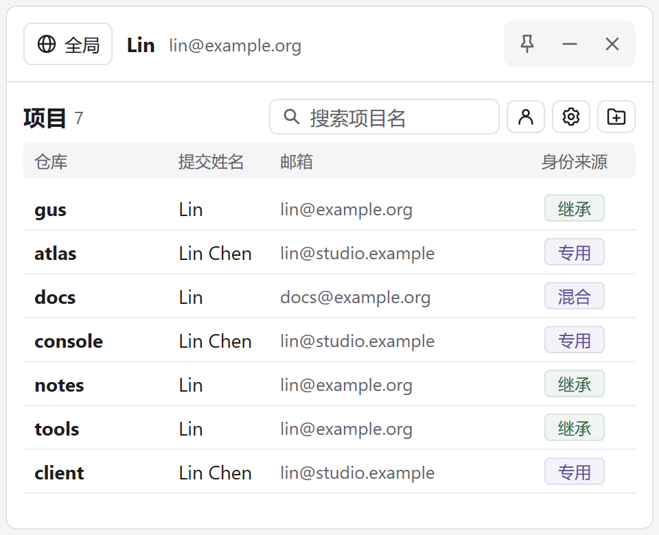

# gus

gus 是一个 Windows 系统托盘工具，用于查看和切换 Git 提交时使用的姓名（`user.name`）和邮箱（`user.email`）。你可以把个人身份设为全局默认值，再给工作仓库单独指定公司身份。每次打开面板，gus 都会重新读取 Git 配置。



## 获取与启动

准备一台 Windows x64 电脑，安装 Git for Windows，并确认在 PowerShell 中运行 `git --version` 能看到版本号。项目已在 Git 2.56 上验证。

- **开发构建**：登录 GitHub，打开最近一次成功的 **Windows build**，在 **Artifacts** 下载 `gus-windows-amd64-dev`，解压后运行 `gus.exe`。[查看构建](https://github.com/Hunlongyu/gus_gui/actions/workflows/build.yml)
- **正式安装包**：手动发布后，可从 Releases 下载安装程序。安装版支持在设置中查看更新日志、校验更新签名并安装重启。[查看 Releases](https://github.com/Hunlongyu/gus_gui/releases)

启动后点击 Windows 通知区域里的 gus 图标打开面板。如果任务栏上找不到图标，展开「显示隐藏的图标」。再次运行 gus 会唤起已有面板。

## 第一次切换身份

1. **保存账号**。点击人像图标 → **新增账号**，填写标签（如「个人」或「工作」）、提交姓名和邮箱。如果顶部已显示你的 Git 身份，可以直接右键它，选择 **保存当前身份为账号…**。
2. **添加项目**。点击文件夹加号选择一个或多个仓库，或先点图钉置顶，再从资源管理器把目录拖入面板。选择仓库的子目录也可以，gus 会定位到根目录并去重。
3. **应用身份**。右键顶部 **全局** 可以修改全局 Git 配置；右键某个项目行可以为该仓库选择账号。要撤销项目覆盖，右键该行选择 **继承全局**。在搜索框输入项目名即可筛选列表。

例如，把「个人」设为全局身份，再右键 `atlas` 选择「工作」，此后在 `atlas` 中的新提交会使用工作邮箱。更改账号模板后，需要在目标项目上再次选择该账号才能应用修改。

## 如何读项目列表

| 身份来源 | 含义 |
| --- | --- |
| 继承 | 姓名和邮箱均来自全局 Git 配置。 |
| 专用 | 两项均来自当前仓库的本地配置，或均来自工作树专用配置。 |
| 混合 | 两项的配置来源不同。例如姓名继承全局，邮箱由仓库覆盖。 |
| 未设置 | Git 配置中没有设置这两项。 |

悬停仓库名可查看完整路径和每个字段的配置作用域。使用 `git worktree` 时，同一仓库的多个工作树可以共享仓库本地配置。要在命令行核对某个项目的实际值及来源，可在该项目目录运行：

```powershell
git config --show-scope --show-origin --get user.name
git config --show-scope --show-origin --get user.email
```

## 设置与数据

齿轮菜单提供开机自启、简体中文 / English，以及跟随系统、浅色和深色三种外观。拖动面板边缘或四角可以调整大小，正常退出后会记住尺寸。

账号模板、项目目录清单、语言和主题保存在 `%APPDATA%\GitUserSwitch\state.json`。实际提交身份由 Git 配置保存。右键项目选择 **移出目录列表** 只会移除 gus 中的记录。

## 从源码构建

当前托盘程序使用 Go 和 MyGo Native UI。工具链版本见 [go.mod](go.mod)，仓库中的 Visual Studio 工程为早期 C++ 实现。

```powershell
git clone https://github.com/Hunlongyu/gus_gui.git
cd gus_gui
go test ./...
go build -trimpath -ldflags "-H windowsgui" -o dist/gus.exe .
.\dist\gus.exe
```

测试使用临时仓库和隔离的全局 Git 配置。

## 发布与许可证

日常推送到 `main` 和提交 PR 会触发 Windows 测试与构建。仅在明确决定发布时更新 [版本配置](mygo.json) 和 [更新日志](CHANGELOG.md)，创建对应的稳定版标签，再从 `main` 手动运行 **Publish Windows release** 并填写标签。工作流使用仓库密钥 `MYGO_UPDATER_PRIVATE_KEY` 签名，验签通过后发布安装包及更新清单。

本项目采用 [MIT 许可证](LICENSE.txt)。
