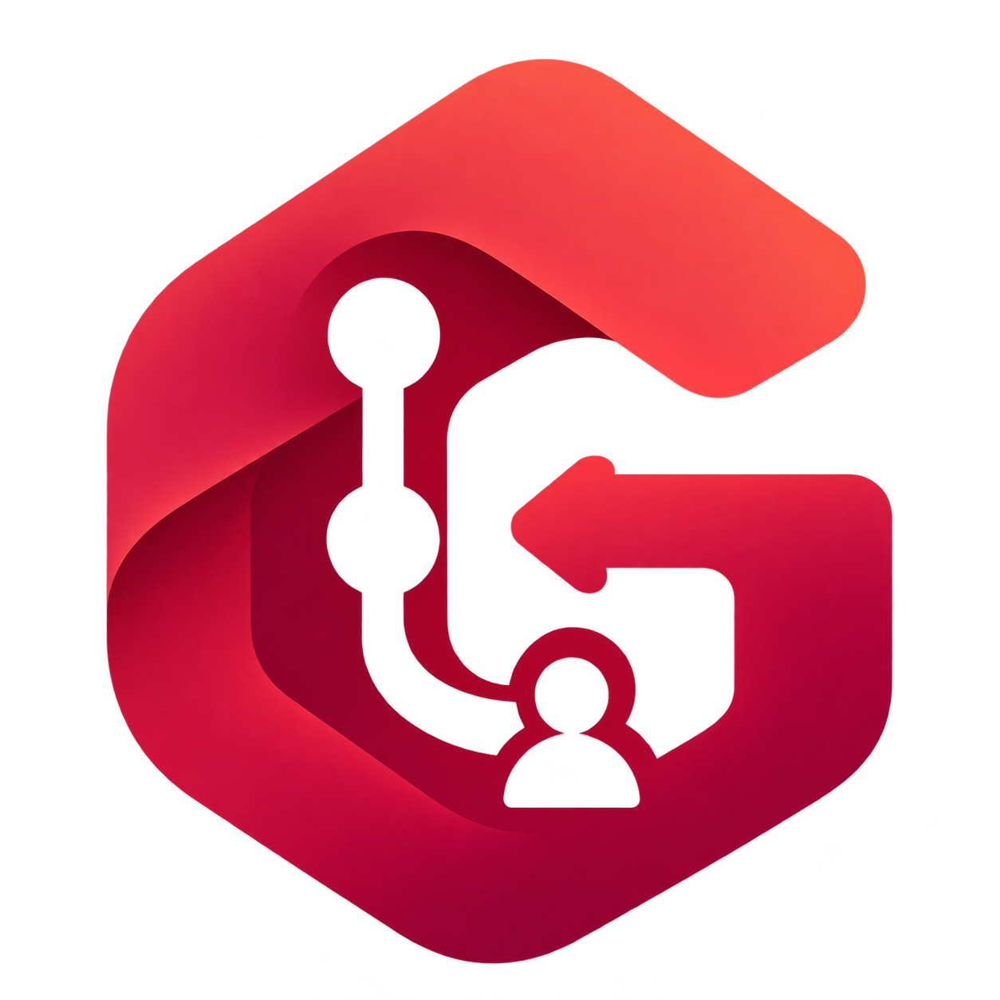
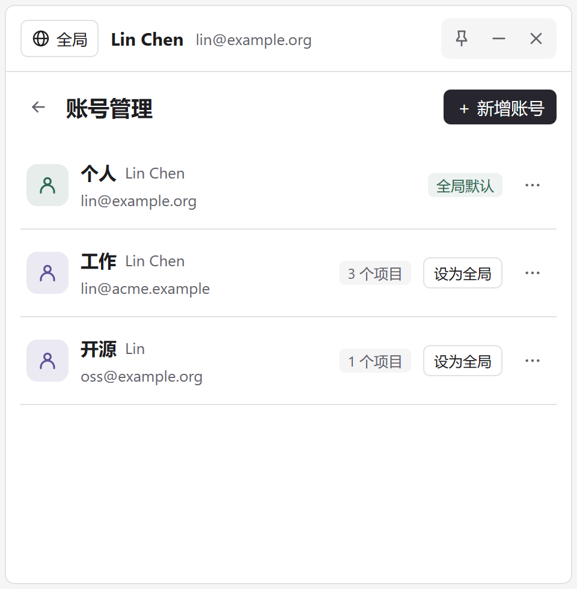
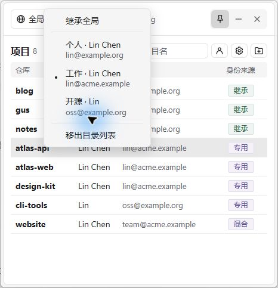
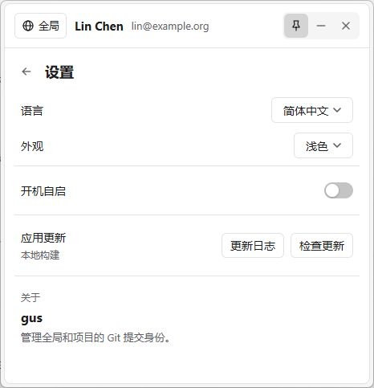

<p align="center">
  
</p>

<h1 align="center">gus</h1>

<p align="center">在 Windows、macOS 和 Linux 上，管理每个 Git 项目的提交身份。</p>

<p align="center">
  <a href="https://github.com/Hunlongyu/gus_gui/releases">下载发布版</a> ·
  <a href="https://github.com/Hunlongyu/gus_gui/actions/workflows/build.yml">开发构建</a> ·
  <a href="CHANGELOG.md">更新日志</a> ·
  <a href="LICENSE.txt">MIT License</a>
</p>

个人项目用私人邮箱，工作项目用公司邮箱。gus 将全局默认身份、项目实际使用的姓名和邮箱放在同一个面板中，右键即可切换，提交前就能确认署名。

<p align="center">
  
</p>

## 功能

- **保存多套身份**：为个人、工作、开源等用途保存姓名与邮箱，查看各身份的使用情况。
- **按项目切换**：设置全局默认身份，或给仓库单独指定身份，也可以恢复继承全局。
- **一眼核对配置**：并排显示仓库、名字、邮箱和配置来源。启动先显示缓存的身份、分支和远程信息，后台并发读取，有变化的项目立即更新并保留滚动位置；可用列表右上角的刷新按钮手动更新，后台每小时也会自动刷新。
- **查看推送平台和详情**：项目列表用堆叠图标显示推送平台，用符号标记身份来源，悬浮可展开查看完整信息，支持多个 remote 和多个推送地址。双击项目行可查看已保存账号、当前分支，以及每个远程仓库的拉取和推送 URL；点击 URL 可用默认浏览器打开仓库，常见 SSH 地址自动转换为网页地址。
- **快速找到项目**：支持多选目录、拖入目录、自动定位仓库根目录、去重和按项目名搜索。
- **常驻托盘**：支持面板置顶、调整尺寸、开机自启、简体中文 / English，以及跟随系统、浅色和深色外观。

gus 管理 Git 的 `user.name` 和 `user.email`。GitHub / GitLab 的登录凭据、访问令牌和 SSH 密钥仍由你原有的工具管理。

## 下载与启动

所有平台均需要已加入 `PATH` 的 **Git**，可运行 `git --version` 确认可用。到 [Releases](https://github.com/Hunlongyu/gus_gui/releases/latest) 选择对应平台；`amd64` 表示 x64，`arm64` 表示 ARM64。

| 平台 | 单文件 / 应用包 | 安装包 |
| --- | --- | --- |
| Windows x64、ARM64 | `gus-<版本>-windows-<架构>.exe`，直接运行 | `gus-setup-<版本>-<架构>.exe` |
| macOS Intel、Apple Silicon | `gus-<版本>-darwin-universal.tar.gz`，解压得到 `gus.app` | `gus-<版本>.dmg`，拖入 Applications |
| Linux x64、ARM64 | `gus-<版本>-linux-<架构>`，添加执行权限后运行 | `gus_<版本>_<架构>.deb`，或使用 `install.sh` 安装 `.tar.gz` |

Windows 和 Linux 单文件已嵌入图标和界面资源，不需要旁边的 PNG、DLL 或资源目录。Linux 仍需系统 **GTK 3** 运行库；Debian/Ubuntu 可用 `sudo apt install libgtk-3-0 git`（Ubuntu 24.04 使用 `libgtk-3-0t64`）。可选安装 `libayatana-appindicator3-1` 并启用桌面的托盘支持。下载单文件后先运行 `chmod +x gus-<版本>-linux-<架构>`。`.deb` 可用 `sudo apt install ./gus_<版本>_<架构>.deb` 安装，自动处理依赖。无需 WebKit 或 WebView2。

macOS 应保留完整的 `.app` 包，不能只复制其中的 Mach-O 文件，否则图标、启动项和更新功能不完整。目前 macOS 构建仅有 ad-hoc 签名，尚无 Apple Developer ID 签名和公证，首次打开可能被 Gatekeeper 拦截。

Windows 启动后从通知区域点击 gus 图标打开面板。macOS 可从菜单栏或 Dock 打开。Linux 启动时显示窗口，最小化后可从任务栏恢复，托盘菜单也可打开面板；没有托盘的桌面仍可正常使用。再次运行程序会唤起已有面板。

开发构建在最近一次成功的 [Cross-platform CI](https://github.com/Hunlongyu/gus_gui/actions/workflows/build.yml) 的 **Artifacts** 中，按系统和架构下载并解压。所有正式发布文件的 SHA-256 校验值见 `SHA256SUMS`。

## 三步开始使用

### 1. 保存身份

点击主面板右上角的人像按钮，进入 **账号管理 → 新增账号**，填写标签、名字和邮箱。例如，保存“个人”和“工作”两套身份。

也可以右键顶部的全局身份，选择 **保存当前身份为账号…**。账号列表会显示“全局默认”或使用该身份的项目数量。

### 2. 添加项目

点击文件夹加号按钮，选择一个或多个 Git 项目目录。也可以先点击图钉置顶面板，再从资源管理器拖入目录。选择仓库中的子目录时，gus 会自动找到根目录，重复添加不会生成重复记录。

### 3. 应用身份

右键项目行，在菜单中选择已保存的账号。在 **账号管理** 中点击账号右侧的 **设为全局**，或右键顶部的 **全局** 区域，可以更改默认身份；为项目选择 **继承全局**，可以撤销它的单独配置。

例如，将“个人”设为全局默认，再为 `atlas-api` 和 `atlas-web` 选择“工作”，这些项目之后的提交就会使用工作邮箱。

<table>
  <tr>
    <th>保存和管理身份</th>
    <th>右键切换项目身份</th>
  </tr>
  <tr>
    <td></td>
    <td></td>
  </tr>
</table>

保存或编辑账号只是更新身份模板，需要在项目上选择该账号才会写入 Git 配置。切换身份不会改写已有提交的作者信息。

## 看懂身份来源

| 标记 | 含义 |
| --- | --- |
| **继承** | 姓名和邮箱均来自全局 Git 配置。 |
| **专用** | 姓名和邮箱均来自仓库本地配置，或均来自工作树专用配置。 |
| **混合** | 两个字段来源不同，例如姓名继承全局、邮箱由项目单独配置。 |
| **未设置** | 没有读取到姓名和邮箱配置。 |
| **不可用** | 项目目录无法访问，或无法读取其 Git 配置。 |

悬停仓库名可查看完整路径与两个字段各自的配置作用域。使用 `git worktree` 时，同一仓库的多个工作树可能共享本地配置。

要在命令行核对身份，可进入对应项目目录运行：

```powershell
git config --show-scope --show-origin --get user.name
git config --show-scope --show-origin --get user.email
```

## 外观与日常使用

点击齿轮进入设置，选择语言和外观，或启用开机自启。启用后，登录系统时会启动并最小化。macOS 自启应使用已放入 Applications 的完整应用包。

<p align="center">
  
</p>

截图使用示例账号和仓库；设置页来自本地构建。

- **图钉**：让面板保持置顶，方便拖入项目或连续切换。
- **最小化**：Windows / macOS 隐藏到托盘；Linux 或托盘不可用时，最小化到任务栏。
- **关闭**：退出程序，也可以在托盘右键菜单中选择“退出”。
- **调整大小**：拖动边缘或四角，正常退出后会记住面板尺寸。
- **应用更新**：安装版在有写入权限时可校验签名后安装并重启。单文件版保留下载文件名时，点击“下载新版”到发布页替换文件，避免更新后重新打开旧文件；Linux `.deb` 建议通过新包升级。

## 数据保存在哪里

账号模板、项目目录列表、语言和外观偏好保存在：

| 平台 | 路径 |
| --- | --- |
| Windows | `%APPDATA%\GitUserSwitch\state.json` |
| macOS | `~/Library/Application Support/GitUserSwitch/state.json` |
| Linux | `$XDG_CONFIG_HOME/GitUserSwitch/state.json`，默认 `~/.config/GitUserSwitch/state.json` |

实际提交身份保存在 Git 配置中。右键项目选择 **移出目录列表** 只会移除 gus 中的记录，项目文件和 Git 配置会保留。备份应用数据时，可复制上面的 `state.json`。

## 从源码构建

当前版本使用 **Go + MyGo Native UI**，Go 工具链版本见 [go.mod](go.mod)。

### 源码组织

项目按 [Go 官方模块布局建议](https://go.dev/doc/modules/layout) 将内部实现按职责拆包。根目录只保留薄入口 `main.go`，负责嵌入图标、更新日志并启动应用，因此现有 `go run .` 和 MyGo 构建命令仍然可用。

```text
main.go                 应用入口与根目录资源嵌入
cmd/legacy-launcher/    旧版 Windows 安装的兼容启动器
internal/
  app/                 桌面 UI、账号和项目交互、托盘、设置与更新
  gitconfig/           Git 命令、身份切换、仓库快照与远程地址解析
  identity/            已保存账号、实际生效身份及作用域规则
  state/               JSON 持久化、偏好设置和窗口尺寸
  pathutil/            跨平台路径与目录别名比较
assets/                内嵌平台图标与 README 截图
resources/             应用图标及打包资源
tests/packaging/       发布归档与签名校验
.github/               CI、打包与启动检查脚本
```

新增代码放入对应职责的包，测试与被测代码放在同一目录；涉及 UI 和存储、Git 协作的测试放在 `internal/app`。`app` 调用底层包，底层包不依赖 UI 或 MyGo；Windows 专用代码保留 `_windows.go` 文件名，其他平台实现使用构建约束。`internal` 中的包只供本项目使用，暂不建立对外的 `pkg` 库。

### 构建与验证

```powershell
git clone https://github.com/Hunlongyu/gus_gui.git
cd gus_gui

go test ./...
go vet ./...
go run github.com/egoist/mygo/cmd/mygo build -platform windows/amd64 -skip-installer -o dist

.\dist\windows-amd64\gus.exe
```

测试使用临时仓库和隔离的全局 Git 配置。`-skip-installer` 生成可执行程序，适合本地运行。MyGo 无需 cgo，可交叉编译：

```sh
go run github.com/egoist/mygo/cmd/mygo build -platform windows/amd64,windows/arm64,linux/amd64,linux/arm64,darwin/universal -skip-installer -skip-dmg -o dist
```

macOS 的签名和 DMG 生成应在 macOS 上执行。完整发布由 GitHub Actions 在各系统原生运行器上打包；Linux 依赖见上文。

启动图标、窗口图标和托盘图标共用 [resources/icon.png](resources/icon.png)。MyGo 构建命令会将多尺寸 Windows 图标嵌入 EXE；直接使用 `go build` 不会生成这些图标资源。

<details>
<summary>维护者：发布流程</summary>

日常推送到 `main` 和提交 PR 会触发 [Cross-platform CI](.github/workflows/build.yml)，在 Windows、macOS、Linux 的 x64 和 ARM64 原生运行器上执行测试、静态检查、编译和独立启动检查，生成六套开发构建。Linux 启动检查运行于 Xvfb / D-Bus 环境，不依赖托盘宿主。启动检查确认进程正常运行，不等同于对所有桌面环境的视觉验收。

发布正式版本时：

1. 更新 [mygo.json](mygo.json) 中的版本号和 [CHANGELOG.md](CHANGELOG.md)。
2. 等待六个平台的 CI 通过，创建与版本号一致的稳定版标签，例如 `v1.4.0`。
3. 从 `main` 手动运行 **Publish cross-platform release**，填写该标签。

[发布工作流](.github/workflows/release.yml) 使用仓库密钥 `MYGO_UPDATER_PRIVATE_KEY` 对每个平台的更新包签名，并验证签名、版本、更新地址和归档中的入口文件。五套发布构建全部完成后，才汇总单文件程序、安装包、更新清单和校验值并发布。相同的安装脚本必须逐字节一致才能去重；已发布版本不允许覆盖。更新签名不等同于 Windows 代码签名或 Apple 公证。

</details>

## 许可证

[MIT](LICENSE.txt)
