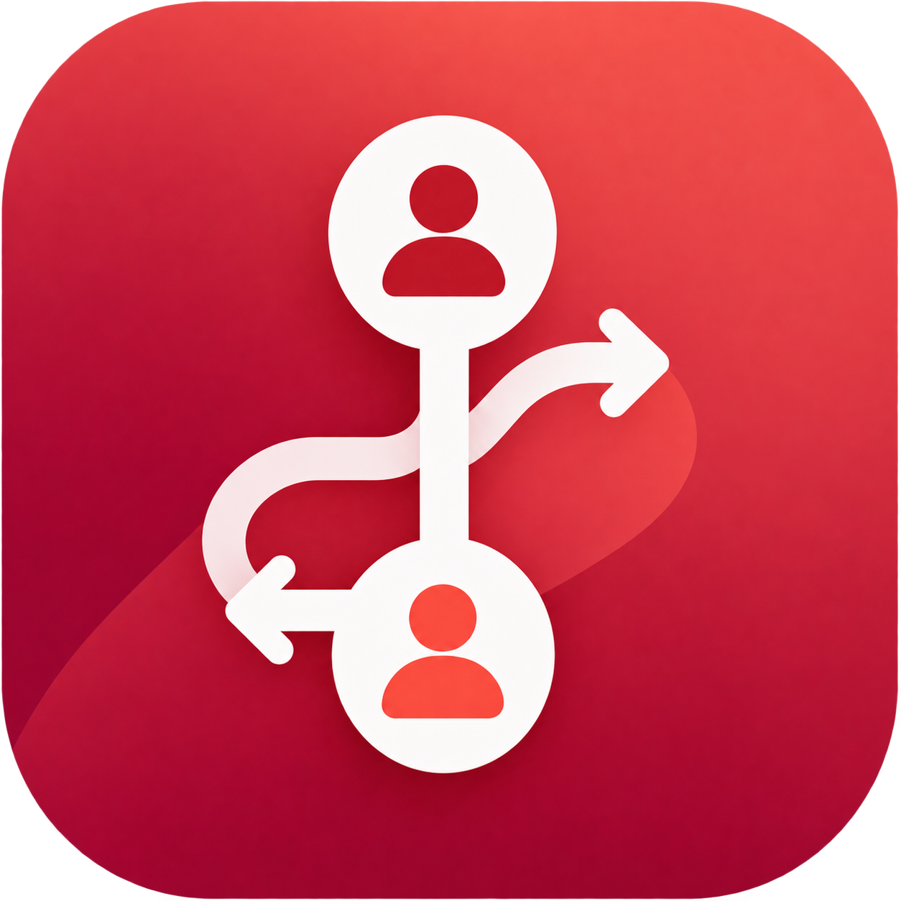
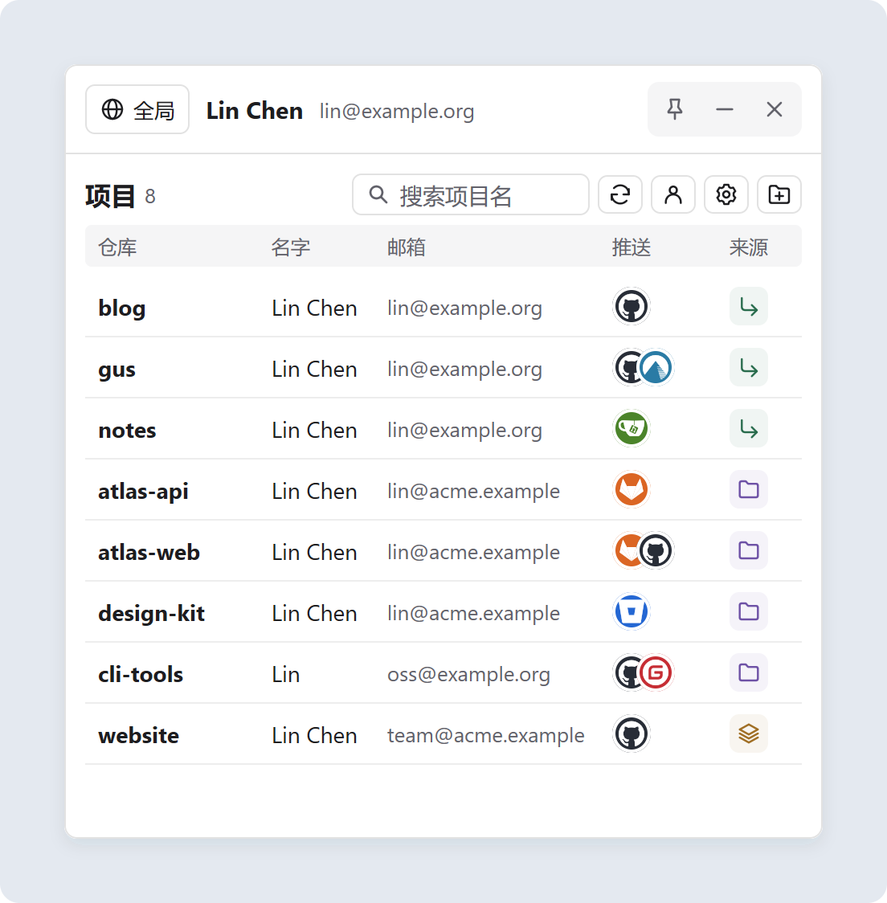
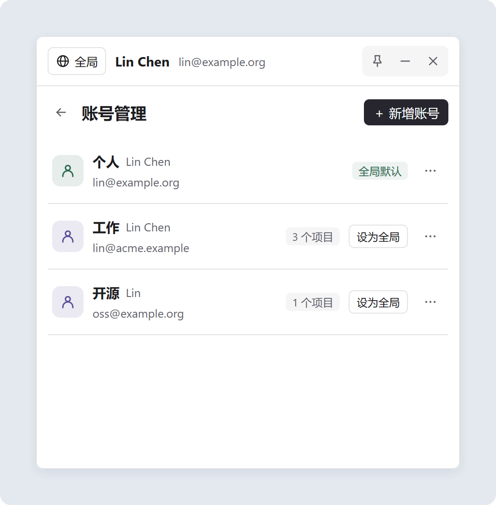
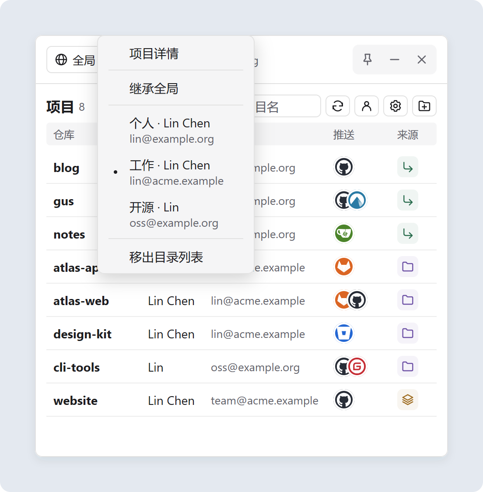
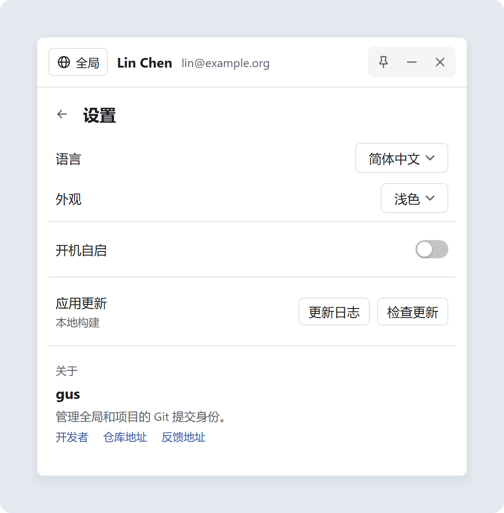

  

<h1 align="center">gus</h1>

  轻松管理每个 Git 仓库的提交身份（姓名与邮箱）。 
  <b>原生桌面界面 · 支持单文件免安装 · 跨平台 Windows / macOS / Linux</b>

  
  
  
  
  

  <a href="README.md">English</a> · <b>简体中文</b>

<!-- 重新生成截图展示外框：go run ./scripts/readme-images -->

  

📸 <b>更多界面截图</b>（账号管理、右键切换身份与设置页）

 
<table align="center">
  <tr>
    <th>账号管理</th>
    <th>右键切换项目身份</th>
  </tr>
  <tr>
    <td></td>
    <td></td>
  </tr>
  <tr>
    <th colspan="2">应用设置</th>
  </tr>
  <tr>
    <td colspan="2" align="center"></td>
  </tr>
</table>

## ✨ 功能特性

- **多套身份模板** — 为个人、工作、开源等不同场景保存 Git 姓名与邮箱（`user.name` / `user.email`），清晰统计各身份关联的项目数量。
- **右键一键切换** — 右键任意项目即可单独指定提交身份或恢复继承全局默认，告别因用错公司/私人邮箱导致的提交署名混乱。
- **配置与平台一目了然** — 并排展示仓库名、生效名字、邮箱、推送托管平台图标（支持 GitHub、GitLab、Gitea、Codeberg、Gitee 等多远程堆叠显示）与配置来源。
- **秒开缓存与并发刷新** — 启动即刻呈现缓存状态，后台高并发读取分支、远程与身份变更，支持手动刷新与定时自动同步。
- **常驻托盘与舒适交互** — 支持窗口置顶、文件夹拖入导入、自动识别仓库根目录、按名搜索、开机自启，以及浅色/深色主题与中英文切换。
- **原生轻量 · 单文件便携** — 原生桌面 UI 构建，无需 Electron 或 WebView2 运行库；提供单文件免安装便携版与标准安装包。

## 📦 下载使用

前往 **[GitHub Releases](https://github.com/Hunlongyu/gus_gui/releases/latest)** 下载对应平台版本：

| 平台 | 单文件便携版 / 应用包 | 安装包 |
| :--- | :--- | :--- |
| **Windows** *(x64 / ARM64)* | `gus-<版本>-windows-<架构>.exe` *(单文件免安装，直接运行)* | `gus-setup-<版本>-<架构>.exe` |
| **macOS** *(Universal)* | `gus-<版本>-darwin-universal.tar.gz` | `gus-<版本>.dmg` |
| **Linux** *(x64 / ARM64)* | `gus-<版本>-linux-<架构>` *(单文件，赋予执行权限运行)* | `gus_<版本>_<架构>.deb` |

> **提示：** 需确保系统 `PATH` 中已安装 `git`。Windows 与 Linux 单文件版已内嵌所有图标与界面资源，无需安装或附带外部文件，下载即可运行。

## ⌨️ 快捷操作与来源标识

| 操作 / 标识 | 说明 |
| :--- | :--- |
| **右键项目行** | 为该项目切换指定身份、恢复继承全局身份，或移出列表 |
| **右键顶部全局栏** | 切换 Git 全局默认身份，或将当前全局身份保存为账号模板 |
| **双击项目行** | 查看当前分支、拉取/推送远程 URL，并支持点击链接在浏览器中打开仓库 |
| **拖入文件夹** | 批量添加 Git 仓库（拖入子目录会自动定位到仓库根目录并去重） |
| **继承** *(绿色图标)* | 项目的姓名和邮箱均继承自全局 Git 配置 |
| **专用** *(紫色图标)* | 项目的姓名和邮箱均由该仓库独立配置 |
| **混合** *(橙色图标)* | 姓名与邮箱来自不同配置层（例如姓名继承全局、邮箱由仓库单独指定） |

## 📄 开源协议

基于 [MIT License](LICENSE.txt) 开源发布。
